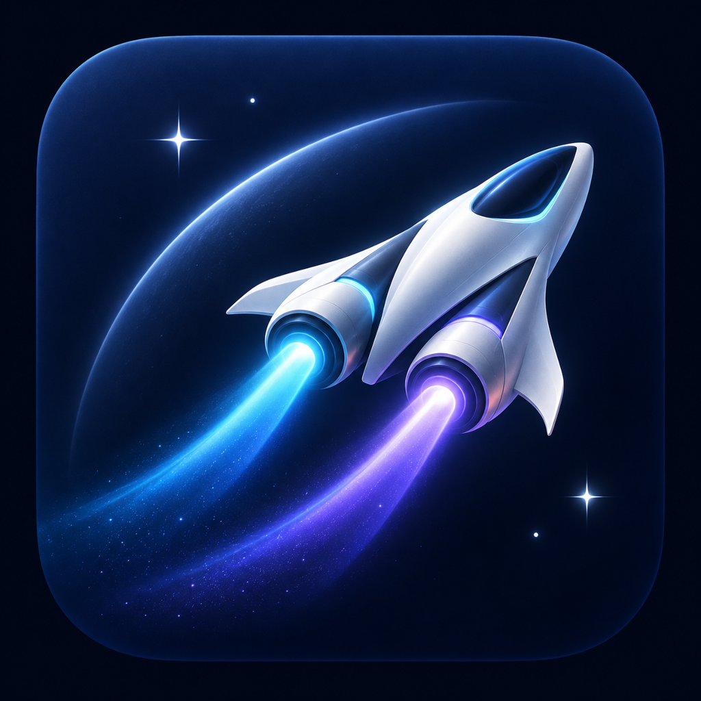

<a id="top"></a>

# Two Code

<div align="center">
  
</div>
<!-- TODO: 建议在此补充 1-2 张真实界面截图（任务时间线 + 主/副手 token 用量面板），中英文共用；截图就位后删除本注释。 -->
<p align="center">
  <strong>主手 + 副手：双模型协作的 Windows 桌面 AI 编码工作台</strong>
</p>
<p align="center">
  简体中文 · <a href="#english">English</a>
</p>

**Two Code** 是一个跑在 Windows 桌面上的 AI 编码工作台：每个任务默认由两个模型协作完成——**主手（lead）** 负责规划、派工与审查，**副手（sidekick）** 负责实现与验证，两者通过原生交接（handoff）传递简报、补充要求和回执。原生界面、任务索引与执行链开箱即用，双模型协调、分角色用量结算与以原生回执为准的验收融为一体。当前版本 **0.8.34**，正处于早期活跃开发阶段。

## 核心特性

### 主手 + 副手，原生交接

- 主手通过派工工具调度副手；每个任务一个持久副手，主副手原生会话身份相互独立。
- 交接简报、运行中补充、副手报告与验证回执逐字写入同一任务事件日志，可按字符分页回读，不与主手对话混淆。
- 运行中的补充要求经原生 steer / interrupt（运行中转向/打断）通道送达等待中的主手；取消后可显式续接，角色会话保留。

### 四套执行引擎，自由搭配

- 内置四套执行引擎：**内置引擎**（随应用自带，V4 会话帧，开箱即用）、**Claude Code**（官方 Agent SDK/CLI）、**Pi**（原生长驻 RPC）、**Step Code**（本机 step.exe 原生 RPC）。
- 模型与引擎是两个独立维度：主副手可以来自不同引擎、不同模型（验收矩阵覆盖 GLM、DeepSeek、Step-5、GPT-6 等组合）。

### 原生界面，没有第二套 UI

- 任务索引、侧栏任务行、聊天时间线、输入器、模型选择菜单与权限弹窗全部原生，直接为双模型协作服务。
- 0.8.34 起，渲染层直接消费**行级增量**（`row.delta`）：未变化的行保持对象身份；连续正文/思考增量按任务节流合并（最高 10Hz、首段即时），状态、权限、错误与终态立即刷新。

### 主 / 副手分开的 token 用量面板

- 每次运行的用量按角色和运行编号分别以回执结算；分块结算与最终结算不会重复计费。
- 面板只显示实际采集到的用量，不把主副手的上下文窗口相加当估计。

### 命名组合与可选副手

- 最多保存 10 套「模型 + 渠道 + 思考档位 + 角色 + 权限模式」组合，任务级一键切换，组合不含凭据。
- 选「副手：无」即单模型模式：不初始化副手、不注入派工工具；已有双模型上下文不销毁。

### 从已完成的回答分叉

- 源任务空闲（非运行）时，从任意一条成功回答的边界创建新任务：主副手原生会话独立、历史截断、分支用量清零，工作区文件不回滚。

### 以原生事实为准的验收

- verification 回执保存原生命令工具的**有界测试摘要与真实返回状态**，不把副手自述当作证据；工具「已完成」不等于需求通过。
- 权限拒绝、中断与未执行分别标记，晚到的结果不能复活已取消的操作。

### 内嵌浏览器与视觉输入

- 主副手共享内置浏览器的标签页操作，只读与变更动作分别裁决权限。
- 图片以原生图像内容块在两角色间传递，导入的图片保存为 Host 持久附件。

## 快速开始

准备 Windows、Git、Node.js **24.14.0** 和 pnpm **10.33.2**（版本以 [mise.toml](mise.toml) 为准）。以下命令均在仓库根目录执行。

```bash
# 安装依赖、准备桌面本地运行资源并完成初始构建
pnpm bootstrap

# 启动桌面应用（开发模式，生产服务配置）
pnpm dev:desktop

# 或使用测试环境配置
pnpm dev:desktop:test

# Web 客户端 + 后端开发模式
pnpm dev:web
```

构建与检查：

```bash
pnpm build      # 递归构建各 workspace 包
pnpm typecheck  # TypeScript 项目引用检查
pnpm lint       # oxlint

# 打包 Windows x64 桌面安装包（输出在 packages/desktop/dist/）
pnpm bundle:desktop -- --os win --arch x64
```

需要独立的开发数据目录时，设置 `ZCODE_DATA_BASE_DIR` 环境变量即可。

## 规格与验收文档

双模型协作的协议边界、性能取舍与真实验收记录集中在 [specs/two-code/](specs/two-code/)（近 40 份规格文档），包括 [多引擎与双角色](specs/two-code/multi-harness.md)、[原生行增量接入](specs/two-code/native-stream-adaptation.md)、[流式性能与回执](specs/two-code/stream-performance-and-receipts.md)、[会话分叉](specs/two-code/session-fork.md)、[命名组合](specs/two-code/named-combinations.md) 等。核心服务契约见 [packages/services/src/two-code/CONTRACT.md](packages/services/src/two-code/CONTRACT.md)。

## 仓库结构

| 目录 | 职责 |
| --- | --- |
| `packages/ui/` | 原生桌面界面：任务时间线、输入器、模型选择与用量面板 |
| `packages/services/src/two-code/` | 双角色协调领域：Coordinator、四套引擎适配器、组合与设置契约 |
| `packages/desktop/` | Electron 桌面壳：窗口、打包与应用图标 |
| `specs/two-code/` | 规格与验收文档：协议边界、性能取舍、真实测试记录 |

## 致谢

- 感谢开源项目 [ZCode](https://github.com/zai-org/ZCode)（Apache-2.0）：Two Code 的前端界面与工程基础站在它的肩膀上。
- 第三方组件声明见 [THIRD-PARTY-NOTICES.md](THIRD-PARTY-NOTICES.md)，项目功能与风险说明见 [NOTICE.md](NOTICE.md)，许可证见 [LICENSE](LICENSE)。

---

<a id="english"></a>

# Two Code (English)

**Two Code** is a Windows desktop AI coding workbench: by default, every task is run by two cooperating models — a **lead** that plans, delegates, and reviews, and a **sidekick** that implements and verifies — connected through native handoffs carrying verbatim briefs, mid-run updates, and receipts. The native UI, task index, and execution stack come built in, with dual-model coordination, per-role usage accounting, and receipt-grounded verification woven through. Current version: **0.8.34**, in active early development.

## Highlights

### A lead and a sidekick, with real handoffs

- The lead dispatches work to the sidekick through a dedicated delegation tool; each task keeps one persistent sidekick with its own native session identity.
- Handoff briefs, mid-run updates, sidekick reports, and verification receipts are stored verbatim in the task's event log and can be paged back through by character — never mixed into the lead's conversation.
- Mid-run user updates reach a waiting lead through native steer / interrupt channels; after cancellation, sessions can be explicitly resumed with roles intact.

### Four execution engines, mixed freely

- Four execution engines are built in: the **bundled engine** (ships with the app, V4 session frames), **Claude Code** (official Agent SDK/CLI), **Pi** (native long-lived RPC), and **Step Code** (local step.exe native RPC).
- Model and engine are independent axes: the lead and sidekick can come from different engines and different models (the acceptance matrix covers GLM, DeepSeek, Step-5, GPT-6 combinations).

### Native UI — no second front end

- Task index, sidebar task rows, conversation timeline, prompt editor, model picker, and permission dialogs are all native components, serving dual-model collaboration directly.
- Since 0.8.34 the renderer consumes **line-level deltas** (`row.delta`): unchanged rows keep object identity; continuous body/thinking increments are coalesced per task (up to 10Hz, first segment immediate), while status, permission, error, and terminal events flush immediately.

### Separate token usage panels per role

- Each run settles usage per role and run number; chunked and final settlements are never billed twice.
- Panels only show actually collected usage — they never add the two roles' context windows together as an estimate.

### Named combinations, optional sidekick

- Save up to 10 named combinations of model + channel + thinking level + roles + permission mode, and switch per task; combinations never contain credentials.
- Choosing "no sidekick" turns a task into single-model mode: no sidekick initialization, no delegation tools injected — existing dual-model context is preserved.

### Fork from any completed answer

- When the source task is idle, fork a new task from the boundary of any successfully answered turn: both native sessions are independent, history is truncated, fork usage starts clean, and workspace files are not rolled back.

### Verification grounded in native facts

- Verification receipts store bounded test summaries and the real return status of native command tools — a sidekick's self-report is never accepted as evidence; a "completed" tool call does not mean the requirement passed.
- Denied, interrupted, and not-executed are distinguished; late results cannot revive a cancelled action.

### Embedded browser and vision

- Lead and sidekick operate tabs of the embedded browser under one task scope, with read-only and mutating actions permitted separately.
- Images travel between roles as native image content blocks; imported images persist as host attachments.

## Getting Started

You need Windows, Git, Node.js **24.14.0**, and pnpm **10.33.2** (see [mise.toml](mise.toml) for the pinned versions). Run everything from the repository root.

```bash
# Install dependencies, prepare local desktop runtime assets, and bootstrap builds
pnpm bootstrap

# Start the desktop app (dev mode, production service config)
pnpm dev:desktop

# Or use the test environment config
pnpm dev:desktop:test

# Web client + backend dev mode
pnpm dev:web
```

Builds and checks:

```bash
pnpm build      # Build every workspace package
pnpm typecheck  # TypeScript project-references check
pnpm lint       # oxlint

# Package the Windows x64 desktop build (output in packages/desktop/dist/)
pnpm bundle:desktop -- --os win --arch x64
```

Set `ZCODE_DATA_BASE_DIR` if you want an isolated development data directory.

## Specs and Acceptance

The protocol boundaries, performance trade-offs, and real acceptance records behind the dual-model collaboration are collected in [specs/two-code/](specs/two-code/) — nearly 40 spec documents, including [multi-harness and dual roles](specs/two-code/multi-harness.md), [native line-delta adaptation](specs/two-code/native-stream-adaptation.md), [stream performance and receipts](specs/two-code/stream-performance-and-receipts.md), [session fork](specs/two-code/session-fork.md), and [named combinations](specs/two-code/named-combinations.md). The core service contract lives in [packages/services/src/two-code/CONTRACT.md](packages/services/src/two-code/CONTRACT.md).

## Repository Layout

| Directory | Responsibility |
| --- | --- |
| `packages/ui/` | Native desktop UI: task timeline, prompt editor, model picker, usage panels |
| `packages/services/src/two-code/` | Dual-role coordination domain: the Coordinator, four engine adapters, combination and settings contracts |
| `packages/desktop/` | Electron shell: windows, packaging, and the app icon |
| `specs/two-code/` | Specs and acceptance documents: protocol boundaries, performance trade-offs, real test records |

## Acknowledgments

- Thanks to the open-source [ZCode](https://github.com/zai-org/ZCode) project (Apache-2.0) — Two Code's front-end interface and engineering foundation build on its shoulders.
- See [THIRD-PARTY-NOTICES.md](THIRD-PARTY-NOTICES.md) for third-party notices, [NOTICE.md](NOTICE.md) for feature and risk statements, and [LICENSE](LICENSE) for the license.
