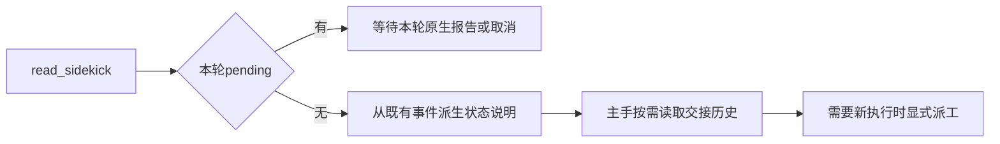

# 四底座实测遗留协作问题

范围是原有144项的适配与交接问题，不重跑旧矩阵、不修改旧成绩，也不直接修改模型生成的CSV产物。已有V4进度、30秒MCP和五分钟HTTP等待修复保持。

## 原生Shell发现

实测Step的run_command报No bash shell found；本机Git位于PATH中的D盘目录，原生默认位置却在C盘。Pi也会将PATH里的System32/bash.exe选为WSL，导致Windows工作区和Windows命令被交给Linux。

PiAdapter启动本机Windows子进程时，从PATH已有git.exe所在安装目录以及标准Git目录发现实际Git Bash，将其目录前置到该子进程PATH；不修改系统PATH、不改变用户全局配置、不将PowerShell命令套进Bash。Linux启动不变。PowerShell仍使用原生powershell工具，扩展仅说明当前命令环境事实。找不到Git Bash则不捏造可用路径。

显式原生shellPath配置仍遵循底座自身的优先级；注入说明只确认PATH已提供Git Bash，不替用户自定义Shell作保证。

## 长失败摘要

CD-PG-medium的FAIL行包含长工作区路径，超过180字符而被整行过滤，造成失败摘要和实际测试记录不一致。verification回执先对完整行执行凭据过滤和摘要识别，再截断长行到180字符并标明省略，保留原来的失败状态及退出码；不将缺失退出码推断为0。原始日志不修改。

## 续问读取副手状态

新一轮ActiveRun不继承上轮pending promise，这是正确隔离；但read_sidekick只返回“本轮尚未派工”错误，无法说明已保存的历史结果，实测造成反复无效读取。

没有本轮pending时，返回明确的状态说明而非伪造报告：本轮无报告，最近一次历史派工是否有后续报告、保留了多少条回执，以及read_handoff_history入口。不得把更早成功报告归给最近中断的交接；不改变sidekickRead，不生成新的handoff_report，不自动派工或重跑工具。正在执行时沿用原pending/取消边界。

重复验证不能仅凭相同命令文本硬拦截：依赖、文件、外部状态可能已变。保留记录，不引入未经证据支持的跳过执行缓存。拒绝/取消后没有报告属于真实未完成事实，不补造报告或回执来抹平计数。

验证覆盖非默认Git位置、System32的WSL不抢占、未找到Git的边界、平台隔离；长FAIL行及行尾凭据；完成/中断/尚未派工的状态读取、旧报告不能冒充新报告。至少一次真实Step订阅原生命令与主副续问验收。

## 0.8.30验证记录

- 原生CLI无模型探针：`native-shell-1791786700607`。Pi/Step修复前均进入Linux/WSL，修复后均为MINGW64，带空格目录保持正确。
- 真实Pi腾讯DeepSeek主手、Step订阅副手：`glm-coordination-1791786911727`。长FAIL原生回执保持failed、退出码7，摘要180字符且显式省略；目标命令仅一次，但模型另外列目录、执行pwd，初始严格单动作验收失败记录保留在results.json。
- 同一任务后续仅读取状态及交接历史，无新派工、无新命令、无伪造新报告；再沿用同一副手会话仅执行一次原生run_command的uname -s，实际为MINGW。功能复核写入followup-results.json，不覆盖初始失败记录。
- 112项模块回归通过；最终环境说明措辞调整后，6项扩展与桥接回归再次通过；typecheck通过，lint 0错误/已有70警告，架构0违规。
