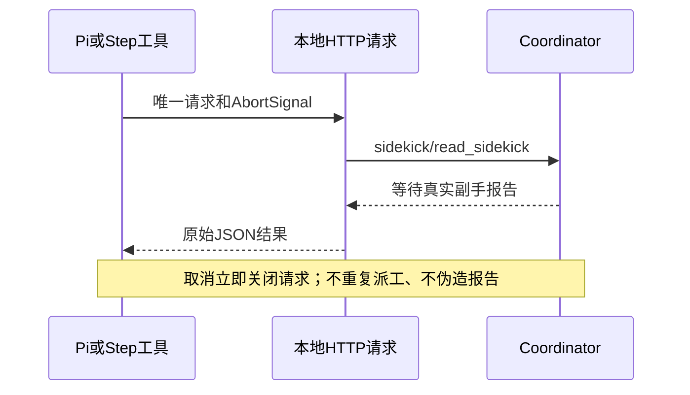

# 本地交接等待的HTTP传输

PD-CG-medium真实任务中，Pi主手阻塞等待Claude副手约五分钟后收到fetch failed，副手仍正常执行。对照本地延迟响应，核实Node fetch的默认headers timeout是否错误地中断长交接。

实测对照已确认：本地同一服务310秒才返回，fetch在305498ms失败，cause=UND_ERR_HEADERS_TIMEOUT；Node HTTP在310043ms收到late-report。候选代码使用相同Node HTTP路径，扩展执行、取消、断连与失败边界另有回归测试。

Coordinator继续作为交接、取消、权限和任务状态的唯一owner。Pi/Step扩展到自有本机ToolBridge的请求使用Node HTTP请求，生命周期服从调用方AbortSignal及连接关闭，不另设短于模型执行的隐式超时、不重试派工。权限通道同样使用这一传输，任何网络/解析失败仍拒绝工具；错误HTTP状态不能作为成功报告。

这只是本地工具传输，不改变模型请求、ZCode MCP执行预算或桌面/远端的交接事实。验证覆盖延迟JSON、HTTP错误、畸形JSON、取消、连接中断、无隐式重试，以及实际生成扩展在原生底座中的执行。
