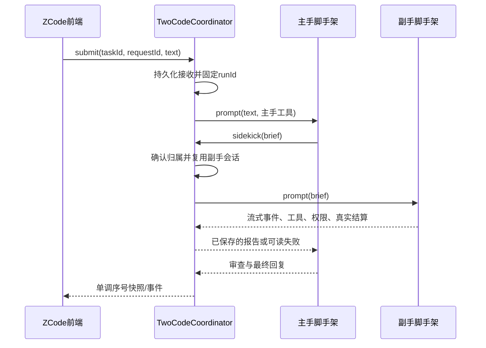

# Two Code：多脚手架与双角色

## 来源与隔离

- 基于全新下载的 ZCode 3.14.3，提交 `29628c9acdb81b703bbd4080c207a0e7ce5e276e`。
- 未修改原版保留在 `D:/Projects/zcode-upstream`；本开发仓库为 `D:/Projects/two-code`。
- 参考 Paseo `6ec663342554bb9c9b50a5e91954aa54e7eb7877` 的 AgentClient/AgentSession、provider adapter、工具目录和父子归属方式，独立实现双角色领域逻辑。
- 产品名 Two Code；app id、协议、桌面快捷方式、窗口、托盘与更新渠道独立。应用与业务数据默认位于 `D:/Apps/TwoCode`，不复用 ZCode/Step Code 的数据库或 Electron 单实例目录。
- 保留上游许可证及 ZCode 自带脚手架。Claude Code 使用官方 Agent SDK/CLI；Pi 使用原生长驻 RPC。模型选择与脚手架选择是两个不同维度。

## 产品入口

首轮实测临时默认：Claude Code 与 Pi 两边均使用腾讯 DeepSeek。仅配置默认值，不将模型与脚手架绑定；后续用户可分别更改任一角色的模型。不得修改两套 CLI 的用户全局默认模型或凭据。

原版聊天功能和 ZCode 执行链保留。在现有工作区侧栏新增「双角色」工作台，可配置主手/副手的脚手架、模型与思考档位；支持单角色运行作对照。每个任务持久保存自己的组合；正在执行时不能偷换组合，变更组合创建新任务。

用户已明确要求：取消首次启动的账号连接门槛，直接进入本地工作台。原生账号和API配置作为自愿入口保留，不伪造登录态或云端权限。

首次启动验收使用独立空白数据目录，不传工作区参数：自动创建本地默认工作区，直接显示双角色工作台，不出现账号欢迎页或职业问卷；再次启动仍能恢复。登录入口仍允许用户主动打开。偏好配置读取须校验结构，写入使用每次独立临时文件原子替换，避免多个窗口竞争同一临时文件。

Bootstrap设置也固定在Two Code自己的根目录；不能读取真实HOME下官方ZCode的setting.json，否则其项目列表和dataBaseDir会穿透隔离。配置并发写入复用共享跨进程文件锁。Deep link注册和解析统一为two-code，不注册官方zcode协议。

工作台展示实际主副手状态、持久会话身份、流式文字、工具摘要、权限请求、错误及历史。送达、执行结束与验收通过分别记录，不将一句“完成”当作产物验收证据。不支持的能力明确禁用，不伪造成功。

## 唯一状态所有者

`TwoCodeCoordinator` 是任务、主副手归属、执行编号、等待者、权限与事件序号的唯一所有者。UI 经 typed service/hook 发命令、读快照；不持有第二套已接受任务队列。原生脚手架各自保存模型上下文，协调器只存会话定位符、公开消息、状态和交接档案。

## 接口与不变量

- 外部接口：catalog、list、create、read、submit、cancel、respond、onDidChange、dispose。
- Adapter 接口：run、cancel、close；流式事件通过运行参数回调。每个角色最多一个活动执行；同任务只有一个持久副手。
- 框架会话身份、模型身份和任务身份分别建模。共享工作目录，但不共享聊天历史对象。
- 主手得到派工工具；副手没有派工工具。工具调用必须绑定当前任务和runId，拒绝跨任务读取及过期执行的结果。
- 用户取消同时取消主副手，拒绝待决权限与工具等待；取消后的迟到完成不能把任务改成成功。
- Windows真实验收发现Claude SDK的interrupt/abort可能留下Bash子进程。适配器须在SDK清理父进程前终止自己创建的进程树；不能按通用进程名清理其他任务。用延迟写文件证明停止后无继续执行。
- 进程退出、SDK错误、RPC错误、超时、模型失败必须可见。恢复任务不自动重跑；先读持久会话，再由用户显式续接。
- requestId去重，先持久化接收再执行；保存失败不谎报未送达或已完成。部分未落盘内容保留内存并提示恢复，不自动重复有副作用的任务。
- CLI/SDK的“prompt accepted”不是完成；Pi等待agent_settled，Claude等待result，ZCode等待原生终态。
- ZCode新建会话与发送统一走V4命令；legacy立即持久化创建再送V4命令在实测中触发外键错误。恢复走IZCodeSessionService，保留原生宿主投影。事件仍读Agent公开合同，不另建原生执行器。
- UI重开以快照为准；事件按sequence订阅补齐。Web使用同一Host实例，不另起执行；暂不暴露未接通的远端能力。
- 权限沿用各框架能力：Claude SDK权限转为工作台交互；Pi默认工具执行语义如实显示，不把cwd宣称为安全沙箱。测试仅操作自建目录。

## 前端设计决策

沿用 ZCode 的密度、主题、text-ui 字体阶梯和组件。特色集中在“主手—副手”双轨角色条：两块紧凑配置卡由交接状态连接；下方一个主会话，副手执行细节可展开。使用上游语义表面与边框，角色区分用克制的靛蓝/青色小标记，不整页铺色。不新增营销大标题、装饰计数或过宽说明。

## 验收

1. 原版源码干净且来源可追溯；原有Step Code/正式ZCode文件不变。
2. 原生ZCode新建会话与消息仍可运行。
3. Claude Code/Pi各自真实小任务、工具执行、失败和恢复可观测。
4. Claude主手+Pi副手以及相反组合均执行派工、回传、主手审查；核对文件与实际工具记录。
5. 模拟覆盖快速完成、拒绝送达、取消、晚到事件、保存失败、恢复、requestId重复和跨任务归属。
6. 工作台真实渲染及交互、权限响应、停止、重开历史验证。后台方式检查，不占用用户鼠标。
7. 桌面快捷方式和独立应用/托盘图标可用；与原版同时运行不争抢单实例锁。
8. 执行typecheck、lint、架构检查及相关测试，明确区分通过、基线错误和未完成项。
