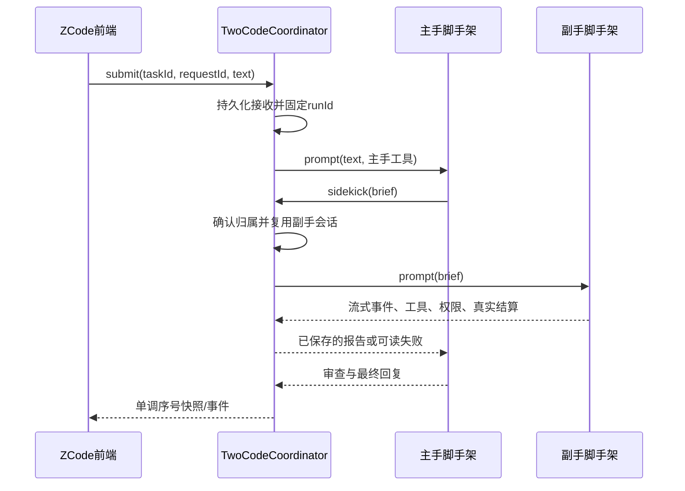
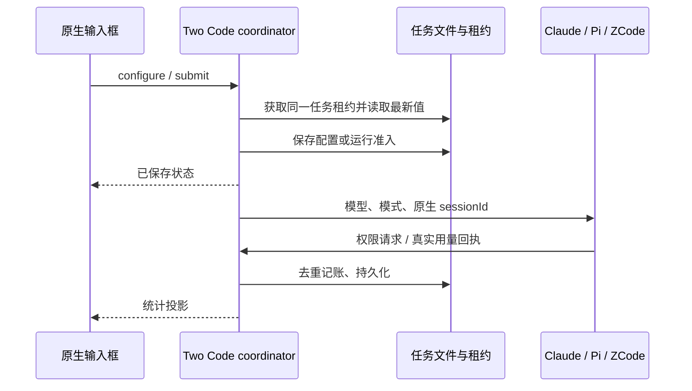

# Two Code：多脚手架与双角色

## 来源与隔离

- 基于全新下载的 ZCode 3.14.3，提交 `29628c9acdb81b703bbd4080c207a0e7ce5e276e`。
- 未修改原版保留在 `D:/Projects/zcode-upstream`；本开发仓库为 `D:/Projects/two-code`。
- 参考 Paseo `6ec663342554bb9c9b50a5e91954aa54e7eb7877` 的 AgentClient/AgentSession、provider adapter、工具目录和父子归属方式，独立实现双角色领域逻辑。
- 产品名 Two Code；app id、协议、桌面快捷方式、窗口、托盘与更新渠道独立。应用与业务数据默认位于 `D:/Apps/TwoCode`，不复用 ZCode/Step Code 的数据库或 Electron 单实例目录。
- 保留上游许可证及 ZCode 自带脚手架。Claude Code 使用官方 Agent SDK/CLI；Pi 使用原生长驻 RPC。模型选择与脚手架选择是两个不同维度。

## 产品入口

首轮实测临时默认：Claude Code 与 Pi 两边均使用腾讯 DeepSeek。仅配置默认值，不将模型与脚手架绑定；后续用户可分别更改任一角色的模型。不得修改两套 CLI 的用户全局默认模型或凭据。

原版聊天功能和 ZCode 执行链保留。双角色直接使用ZCode原生任务入口、任务索引、侧栏任务行、聊天时间线、Lexical输入器、模型选择菜单和文件预览。删除独立「双角色」页面及第二份任务列表。主副手、脚手架与思考配置位于输入器紧凑工具栏和按需弹层。每个任务保存自己的组合；正在执行时不能偷换组合，变更组合创建新任务。

用户已明确要求：取消首次启动的账号连接门槛，直接进入本地工作台。原生账号和API配置作为自愿入口保留，不伪造登录态或云端权限。

首次启动验收使用独立空白数据目录，不传工作区参数：自动创建本地默认工作区，直接显示原生聊天首页，不出现账号欢迎页或职业问卷；再次启动仍能恢复。登录入口仍允许用户主动打开。偏好配置读取须校验结构，写入使用每次独立临时文件原子替换，避免多个窗口竞争同一临时文件。

Bootstrap设置也固定在Two Code自己的根目录；不能读取真实HOME下官方ZCode的setting.json，否则其项目列表和dataBaseDir会穿透隔离。配置并发写入复用共享跨进程文件锁。Deep link注册和解析统一为two-code，不注册官方zcode协议。

工作台展示实际主副手状态、持久会话身份、流式文字、工具摘要、权限请求、错误及历史。送达、执行结束与验收通过分别记录，不将一句“完成”当作产物验收证据。不支持的能力明确禁用，不伪造成功。

## 唯一状态所有者

`TwoCodeCoordinator` 是任务、主副手归属、执行编号、等待者、权限与事件序号的唯一所有者。UI 经 typed service/hook 发命令、读快照；不持有第二套已接受任务队列。原生脚手架各自保存模型上下文，协调器只存会话定位符、公开消息、状态和交接档案。

## 接口与不变量

- 外部接口：catalog、list、create、read、submit、cancel、respond、onDidChange、dispose。
- Adapter 接口：run、cancel、close；流式事件通过运行参数回调。每个角色最多一个活动执行；同任务只有一个持久副手。
- 框架会话身份、模型身份和任务身份分别建模。共享工作目录，但不共享聊天历史对象。
- 主手得到派工工具；副手没有派工工具。工具调用必须绑定当前任务和runId，拒绝跨任务读取及过期执行的结果。
- 用户取消同时取消主副手，拒绝待决权限与工具等待；取消后的迟到完成不能把任务改成成功。
- Windows真实验收发现Claude SDK的interrupt/abort可能留下Bash子进程。适配器须在SDK清理父进程前终止自己创建的进程树；不能按通用进程名清理其他任务。用延迟写文件证明停止后无继续执行。
- 进程退出、SDK错误、RPC错误、超时、模型失败必须可见。恢复任务不自动重跑；先读持久会话，再由用户显式续接。
- requestId去重，先持久化接收再执行；保存失败不谎报未送达或已完成。部分未落盘内容保留内存并提示恢复，不自动重复有副作用的任务。
- CLI/SDK的“prompt accepted”不是完成；Pi等待agent_settled，Claude等待result，ZCode等待原生终态。
- ZCode新建会话与发送统一走V4命令；legacy立即持久化创建再送V4命令在实测中触发外键错误。恢复走IZCodeSessionService，保留原生宿主投影。事件仍读Agent公开合同，不另建原生执行器。
- UI重开以快照为准；事件按sequence订阅补齐。Web使用同一Host实例，不另起执行；暂不暴露未接通的远端能力。
- 权限沿用各框架能力：Claude SDK权限转为工作台交互；Pi默认工具执行语义如实显示，不把cwd宣称为安全沙箱。测试仅操作自建目录。

## 前端设计决策

沿用ZCode的密度、主题、text-ui字体阶梯。布局只有原生侧栏和聊天区；复用ConversationDraftEmptyState、ConversationTimeline、ChatPromptEditor、ModelConfigSelect。签名仅为输入器上的紧凑「双角色」入口和副手消息的可展开执行记录。配置卡按需在原生Popover内出现，主页面不常驻第二栏。模型名称用友好标签，ID放到配置详情。配色沿用黑灰背景、浅色文字、原生菜单表面和品牌色，不新增大标题。

### 原生集成状态边界

- TwoCodeCoordinator继续唯一拥有执行和会话数据；ZCode tasks-index唯一拥有置顶、归档、重命名、分组等组织元数据。
- Two Code任务以`two-code:<uuid>`作为原生任务地址。索引是可重建投影；旧JSON任务启动时幂等投影，原生列表和搜索即能找到。更新投影保留原生组织元数据及删除墓碑。
- 原生SessionPane按地址选择适配视图，复用同一时间线和输入壳；新增适配视图不能自行维护侧栏或选中任务真相。选中和新建继续由原生pane/workspace store负责。
- 模型配置由服务保存；输入器模型菜单使用原生ModelConfigSelect。当前兼容别名不代表模型被绑定；主副手模型可独立修改。
- 所有显示行由事件序号纯投影为原生ConversationRow；Markdown、代码、复制、滚动与文件预览复用原生组件。未接通的编辑重跑/分叉能力不声明可用。
- 验收必须覆盖：旧任务可见、发送即进入原生侧栏、选择历史、刷新恢复、重命名/置顶/归档、新任务与双向派工；页面不得出现第二个任务列表或「双角色工作台」。

## 验收

1. 原版源码干净且来源可追溯；原有Step Code/正式ZCode文件不变。
2. 原生ZCode新建会话与消息仍可运行。
3. Claude Code/Pi各自真实小任务、工具执行、失败和恢复可观测。
4. Claude主手+Pi副手以及相反组合均执行派工、回传、主手审查；核对文件与实际工具记录。
5. 模拟覆盖快速完成、拒绝送达、取消、晚到事件、保存失败、恢复、requestId重复和跨任务归属。
6. 工作台真实渲染及交互、权限响应、停止、重开历史验证。后台方式检查，不占用用户鼠标。
7. 桌面快捷方式和独立应用/托盘图标可用；与原版同时运行不争抢单实例锁。
8. 执行typecheck、lint、架构检查及相关测试，明确区分通过、基线错误和未完成项。

# 2026-10-10：任务配置与统计

- 已有任务空闲时可独立修改主手、副手模型和思考档位；下轮使用新选择，同脚手架保留原生 sessionId。运行及配置保存期间拒绝并发修改。跨脚手架不复用原生 sessionId；已有原生上下文的角色需新建任务更换脚手架，模型切换不受此限制。
- 配置由 coordinator 持有，通过任务执行租约串行保存并广播。全局偏好只用于新任务。旧快照缺少模式时按 build（变更前确认）迁移。
- 复用原生权限选择器：plan 只读且不执行 shell/写入；build 读取可直接执行，修改及 shell 请求确认；edit 自动编辑工作区内文件，shell/工作区外修改仍确认；yolo 完全访问。两角色继承任务模式。Claude/Pi 工具前置门禁执行相同规则；ZCode 使用原生模式。不得依靠提示词替代门禁。
- 只读复制阶跃星辰实际源项目的 SessionStatisticsBar 及统计类型，保留输入框下方原样位置与弹层。统计来自适配器真实回执，按角色、原生运行唯一编号记账；重启与重放不得重复累计。旧任务未采集的历史不估算。主副手 token 合计，原生 context 不跨角色相加；未知耗时/速率显示空值。
- 验收：空闲切换两角色模型并复用 session；busy 拒绝、保存失败不污染；四模式真实读写权限；两角色用量求和、重复回执与重启稳定；桌面隐藏窗口检查下拉菜单、统计弹层及位置。源项目文件 hash 前后相同。

# 2026-10-10：角色面板与原生思考链对接

- 底部保留权限、单/双角色、主手、副手四个入口。角色按钮各自打开独立Popover：脚手架、搜索模型列表、思考档位、管理入口。选模型即保存并关闭；档位保存后保持面板；失败保留原选择并展示错误。不得在点击主手时强制配置副手。
- 双角色菜单保留开关、组合设置、设为新任务默认组合、原生模式入口。关闭副手保留配置；已有上下文的脚手架更换提示新建任务，模型仍可更换。运行中禁用变更。
- 统一展示本机模型目录及脚手架兼容信息；不兼容条目不静默切换脚手架。Claude目录从本机模型映射读取，Pi目录沿用本机配置；高级配置保留模型ID、名称、提供方、思考字段。连接认证沿用对应脚手架已有配置，原生ZCode模型与连接管理复用设置入口。
- 思考链只对接：Claude thinking_delta、Pi thinking_delta、ZCode原生reasoning part接入TaskEvent.reasoning，持久化后投影为原生ReasoningRow。复用ConversationTimeline、已工作折叠区域、ReasoningRowView以及messageStreamShowReasoning设置，不另造思考面板，不合并思考到回答正文。
- 主副手思考按事件顺序保留且可区分；旧任务缺失的事件不伪造。取消将尚在流式的思考标为interrupted；刷新读取同一事件快照，不能重复追加。
- 验收：角色面板独立、搜索/提供方辨识/兼容禁用、档位和默认组合持久化、旧会话不清空；三脚手架真实reasoning回执、原生折叠可展开、显示设置/刷新/取消测试；后台离屏截图且不操作物理输入。

# 2026-10-10：简洁模型名称与清晰菜单

- 角色面板删除“其他脚手架模型”，只列当前脚手架可选项；每个模型仅一行名称，删除提供方/模型ID介绍行，搜索提示改为“搜索模型”。底部按钮及配置摘要使用同一名称解析。
- Claude别名先解析本机映射，再读取已配置本地网关的只读路由元数据确认上游model；Pi按本机连接对应路由确认。相同可执行路由只显示一次，旧sonnet/opus/haiku选择以aliases匹配，展示变化不得改写执行选择或原生会话。无法确认代理背后的模型时明确显示待确认，不猜名称。远程API不进行未授权探测。
- 思考档位使用单行下拉框保留原有全部档位；隐藏时只显示当前选择，避免多行按钮堆积。
- 双角色菜单只保留单/双角色切换与保存新任务默认配置，分隔两个作用范围。删除重复的“组合设置/主副手配置”入口，模型与脚手架统一从各自角色按钮进入；单角色仍保留副手配置供重新启用。原生模式入口保留。
- 验收：路由元数据变更反映到真实名称、别名去重及旧任务选中态；读取失败不冒充真实模型；下拉档位保存；菜单作用域、单/双角色切换与原生入口不丢失；离屏UI检查，无物理输入操作。
# 2026-10-10：统一脚手架模型设置

- 图四“模型设置”作为唯一管理页面：顶部切换ZCode/Claude Code/Pi，左侧连接列表，右侧连接信息与模型表。ZCode保留原生供应商/OAuth管理，另外两种脚手架提供连接与模型新增、编辑、移除。聊天入口带脚手架定位直接跳转，不再保留独立管理弹窗。
- 未验证上游名称时保留本机配置名称或请求ID，名称不会被统一替换成“模型待确认”；核验状态仅在管理表中显示。已验证上游名仍优先。思考/脚手架下拉使用ZCode现有Select，支持键盘和统一主题。
- 模型设置由Host的TwoCodeConnections唯一持有；本机配置只读导入，编辑结果写入Two Code私有文件并带revision并发校验，空密钥保留旧值，读取响应不返回密钥。移除只隐藏/移除Two Code中的连接，不修改本机Claude/Pi原配置。失败不发布新目录。
- 保存成功广播catalog变化，聊天通过同一服务重读。运行准入时冻结两角色连接快照，下轮才使用设置更改。Claude通过本次SDK settings/env注入；Pi通过本次角色独立agent目录的models.json和PI_CODING_AGENT_DIR注入，保留原生sessionId。没有覆盖配置的连接继续沿用本机行为。
- 验收：旧名称可辨识、原生Select主题；聊天入口定位正确；管理页增改删/密钥保留/并发拒绝/刷新重读/目录同步；两个适配器真实使用保存的私有连接，原本机文件hash不变；ZCode原生设置可继续访问。

设置事件顺序：聊天入口 → 原生设置导航 → TwoCodeConnections 读取/校验 revision → 私有文件原子保存 → catalog 事件 → 聊天重读。刷新页面沿用 ZCode 临时标签语义返回任务，重新进入设置读取已保存数据。

0.6.0 验收：保存连接的真实双角色小任务返回 23×29=667；安装包后台 UI 短测覆盖脚手架定位、连接增改删、空密钥保留、重载与模型同步、原生 ZCode 设置，renderer 无异常；实际用户数据中的 4 个旧任务可打开。typecheck、lint（71 个既有 warning、0 error）及架构检查通过，15 项针对性服务回归通过。Claude/Pi 原配置哈希未变化。证据目录为 D:/Apps/TwoCode/qa/managed-live-1791636249177 和 D:/Apps/TwoCode/qa/integration-1791637116894。
