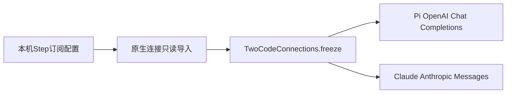

# Step-5订阅跨脚手架

目标：在Two Code的Pi及Claude Code模型菜单中提供现有Step-5订阅，用户可选为主手、副手或单模型，保留Step Code原有API和订阅两条连接。

连接唯一来源是本机`.stepcode/models.json`中的`step-plan`。连接适配层只读导入，每轮经TwoCodeConnections.freeze冻结后交给原生脚手架；不改用户的Claude/Pi全局配置，不将密钥写入源码、UI、日志或报告。不新建网关。导入身份为`native:pi:step-plan`和`native:claude-code:step-plan`，provider均为`step-plan`；已有Pi同provider连接优先，Two Code保存的同ID覆盖和删除沿用现有机制。

只有已知官方订阅地址`https://api.stepfun.com/step_plan/v1`才生成跨脚手架连接；自定义端点不猜测协议或移送凭据。Pi保留该地址，Claude使用`https://api.stepfun.com/step_plan`和Bearer token认证。模型ID固定为`step-5-preview`，显示名`Step-5 订阅`；复用输入模态/上下文/输出上限元数据，排除Step Code专用compat，不额外扩展到API计费渠道。low/medium/high沿用统一模型能力，默认medium。请求失败应原样报错，不回退API或其他模型。

官方协议依据（2026-10-12）：

- https://platform.stepfun.com/docs/zh/guides/developer/integrations/claude-code
- https://platform.stepfun.com/docs/zh/step-plan/integrations/reasoning-api

验证：导入/冻结/删改/凭据隐藏和同provider冲突回归；原生Pi与Claude交换主副手完成文件读写、命令验收及续轮任务；核对真实模型和会话、目录保持隔离。打包后后台UI核对两个菜单都出现该模型；仅在无运行中任务时将新版本重启到桌面。测试使用完全访问并清理所属临时任务和会话。

## 0.8.26验收

2026-10-12：12项连接/档位/权限回归通过。Pi→Claude与Claude→Pi均实际调用step-5-preview，两个方向各完成小代码任务和只读续轮，两次交接报告完整、主副手会话保持不变，工具错误0、待审批0。Pi主手→Claude副手首轮有一次同源码重复通过验证（为了补退出码）；原测试脚本错误要求总验证数恒为1，已改成单独计数首轮重复、严格断言只读续轮不重验。没有重新计费运行来掩盖该记录；原始失败断言及重新复核证据均保留。

完整0.8.26包后台UI验收通过：Pi/Claude各可选主手或副手，Step-5订阅、低中高档和配置地址正确，刷新保持选择，密钥输入框为空，页面异常0。证据目录：`D:\Apps\TwoCode\reports\step-plan-harness-1791772422402`。实测未覆盖图像输入或长上下文；图像模态元数据保留已做回归验证。
