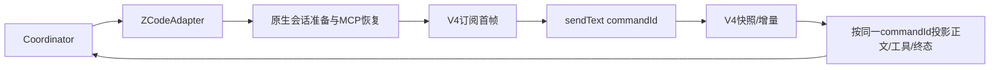

# ZCode适配器使用V4会话事实

四底座实测确认旧`onDynamicSessionEvent`链路丢弃当前CLI的tool.updated/turn.started新增字段，旧session/resume响应中的message结构也与旧历史schema不兼容。原生执行本身完成，但Two Code缺少正文、思考、工具状态及verification，续接可能失败。用户要求先修复ZCode再继续公平对比。

保留Coordinator为唯一任务/权限/交接owner；ZCode原生拥有上下文与工具执行。Adapter只消费V4会话订阅的快照/增量，复用shared的wire assembler和delta reducer，按topic/subscriptionId/seq过滤迟到或不连续帧，不将ACK当完成、不重放已有历史为本轮输出。以本轮sendText的commandId对应turnHeader为关联边界；正文/思考按rowId差量输出，工具按toolCallId只结算一次，真实命令结果复用verificationEvent，参数预览仍只限文件写入类且最多20000字符。

已有会话的执行准备继续复用CLI的session/resume副作用以更新MCP地址和工具限制，但服务层新增`prepareSessionExecution`窄接口，只验证返回的session身份，不读取无用的旧消息投影；模型/模式仍随本轮sendText冻结。它不拥有新状态，原生会话ID不可替换。相同Adapter多次交接只持有一个ToolBridge，结束后关闭。原生用量按轮差分。

真实界面回放发现原生工具名`mcp__two_code__sidekick`未与已有sidekick草稿合并，导致一次派工显示两行。显示投影只剥离自有MCP命名空间，不改原生调用ID、不合并其他MCP工具；交接开始后沿用既有草稿合并逻辑，副手Read/Write仍显示在该次交接详情内。

权限来自V4 pendingInteractions，只选择本次工具的单次允许/拒绝选项，不扩大为始终允许；重复帧不重复询问，明确拒绝才标not-executed。未支持的用户问答/Hook交互显式失败，不自动编造答案。取消先使本轮失败并调用stop，迟到帧不能提交成功。帧缺口/物理校验失败显式报错，不拼接可能错乱的内容；健康新快照重放必须幂等。

后续ZG-PS中任务确认原生MCP默认30秒执行上限把正常的阻塞派工/读报告误报为超时。自有two_code会话MCP声明30分钟执行预算，适用于创建和恢复会话，不修改其他MCP服务或任务权限；任务取消仍立即发送stop并中止本轮。此预算匹配等待模型执行的长工具语义，不掩盖断流或序列错误。回归需要真实副手执行超过35秒再报告，原生派工工具必须成功且只交接一次，旧矩阵结果不重跑。

验证必须覆盖：只有V4事件的真实接口形状、ACK前首帧、旧完成历史、正文和思考增量、工具失败/验证摘要、重复帧、取消、同一原生会话两次交接及关闭后的续问。使用真实GLM-5.3 max与其他脚手架组成小任务验证，并在后台UI检查工具/输出出现。矩阵暂停派发；按用户最新要求，之前所有已测结果保留、不重跑，修复后只继续未测任务，明确标出版本边界，不将跨版本矩阵描述为统一版本对照。
